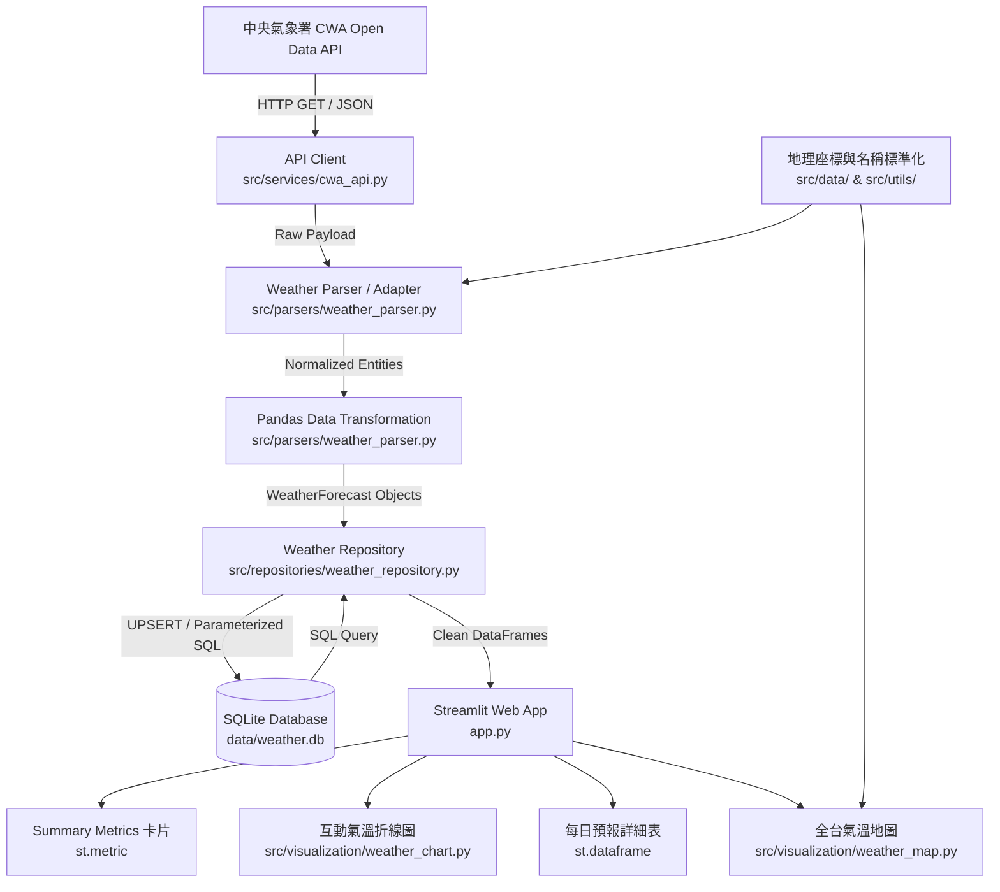
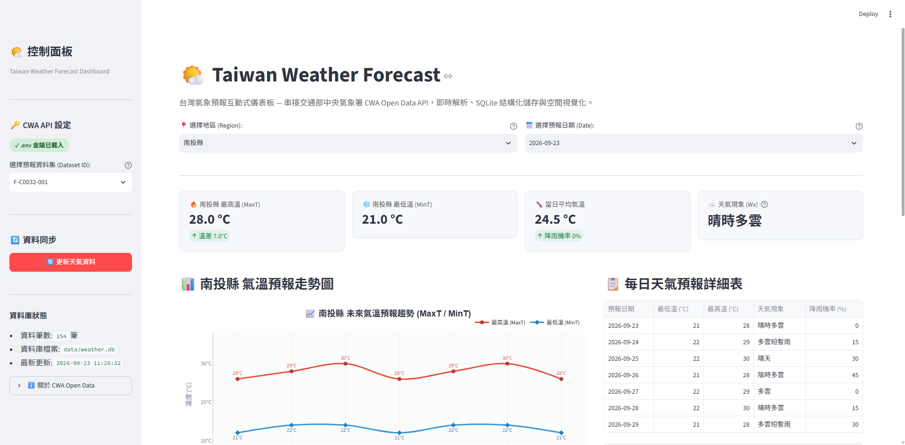
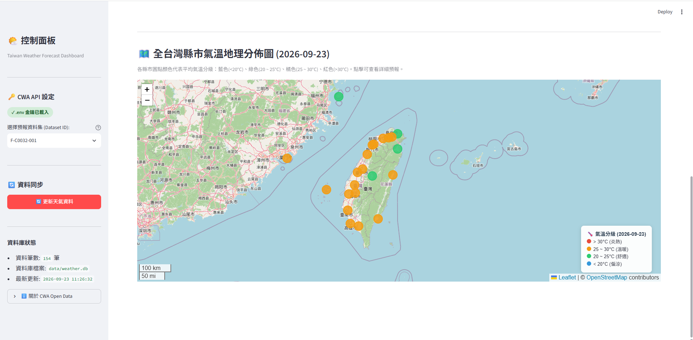

# Taiwan Weather Forecast — 台灣天氣預報互動式 Web App

[](https://www.python.org/)
[](https://streamlit.io/)
[](https://www.sqlite.org/)
[](https://plotly.com/)
[](https://python-visualization.github.io/folium/)
[](https://opensource.org/licenses/MIT)

一套架構完整、模組化分層設計的台灣即時天氣預報互動式系統。本專案非單純靜態展示，而是實作從 **中央氣象署 (CWA) Open Data API 串接**、**HTTP 錯誤處理**、**多資料集 JSON 解析**、**Pandas 資料清洗**、**SQLite 結構化儲存 (UPSERT)**、**參數化 SQL 查詢**，到 **Streamlit 互動儀表板**、**Plotly 氣溫趨勢圖** 與 **Folium 台灣氣溫分級地圖** 的全流程實戰專案。

---

## 📌 系統流程與架構圖

本系統遵循關注點分離原則（Separation of Concerns），嚴格劃分資料獲取、解析清洗、持久化與表現層：



---

## 🌟 核心特色 (Features)

1. **中央氣象署 CWA Open Data 串接**：
   - 支援 36 小時天氣預報 (`F-C0032-001`) 與未來 1 週天氣預報 (`F-D0047-089` / `F-D0047-091`)。
   - 封裝獨立 `CWAClient`，嚴格處理 Timeout、Connection Error、HTTP 401/403、JSON 解析錯誤，絕不在日誌或前端洩漏金鑰。
2. **強韌 JSON 解析器 (Adapter Pattern)**：
   - 封裝為 `WeatherParser`，相容 CWA 不同資料集的階層結構差異（如 `records.location` vs `records.locations`）。
   - 解析各地區最高溫 (`MaxT`)、最低溫 (`MinT`)、天氣現象 (`Wx`) 與降雨機率 (`PoP`)。
   - 自動聚合單日內多時段預報，計算出嚴謹的單日最高溫與最低溫。
3. **台灣地名標準化與經緯度映射**：
   - 自動將「台」轉換為標準「臺」（如 `台北市` 轉換為 `臺北市`）。
   - 內建 22 縣市地理中心座標映射庫，支援快速地理視覺化。
4. **Pandas 資料整理與型別清洗**：
   - 轉換為強型別 DataFrame，自動補齊、排序、去重與空值安全防護。
5. **SQLite 資料庫與 UPSERT 機制**：
   - 資料表 `temperature_forecasts` 建立 `UNIQUE(region_name, data_date)` 約束。
   - 寫入時使用 `INSERT ... ON CONFLICT DO UPDATE`，確保重複抓取時更新歷史與最新預報，不產生重複髒資料。
6. **防注入 SQL Parameterized Queries**：
   - 禁止任何 SQL 字串拼接，一律採用參數化查詢（`?` 佔位符）。
7. **Streamlit 現代化儀表板**：
   - **地區篩選**：從 SQLite `SELECT DISTINCT region_name` 動態生成下拉選單。
   - **日期篩選**：連動全台地圖與單日各項指標。
   - **指標卡片 (`st.metric`)**：呈現最高溫、最低溫、平均溫與日溫差。
   - **互動折線圖 (Plotly)**：雙曲線展示未來氣溫走勢，具備懸浮數值與圖例。
   - **詳細資料表**：支援一鍵下載 CSV。
   - **全台溫度分級地圖 (Folium + streamlit-folium)**：
     - 依平均氣溫分級：低溫 `<20°C` (藍)、舒適 `20~25°C` (綠)、溫暖 `25~30°C` (橘)、炎熱 `>30°C` (紅)。
     - 標記點具備懸浮 Tooltip 與豐富點擊 Popup 預報視窗。
   - **一鍵線上同步**：側邊欄提供「更新天氣資料」按鈕，同步時顯示 Spinner，完成後提示並自動重新整理。

---

## 🗂️ 專案目錄結構

```text
L3CWAv2/
├── app.py                     # Streamlit 主程式進入點
├── requirements.txt           # 專案依賴清單
├── README.md                  # 專案說明文件
├── .env.example               # 環境變數範例檔
├── .env                       # 本地環境變數 (排除於 git)
├── .gitignore                 # Git 忽略設定
├── pyproject.toml             # Pytest 設定檔
│
├── data/
│   ├── taiwan_locations.json  # 台灣 22 縣市中心經緯度對照表
│   └── weather.db             # SQLite 資料庫檔案 (執行後生成)
│
├── src/
│   ├── config/
│   │   └── settings.py        # 環境設定與 .env 讀取管理
│   ├── models/
│   │   └── weather.py         # WeatherForecast 資料模型 (Dataclass)
│   ├── services/
│   │   └── cwa_api.py         # CWA API 請求客戶端與例外體系
│   ├── parsers/
│   │   └── weather_parser.py  # CWA JSON 多格式解析與 Pandas 轉換
│   ├── database/
│   │   └── database.py        # SQLite 連線管理與資料表結構初始化
│   ├── repositories/
│   │   └── weather_repository.py # 參數化 SQL 查詢與 UPSERT 操作
│   ├── data/
│   │   ├── taiwan_locations.py   # 縣市經緯度字典與載入器
│   │   └── seed_data.py          # 氣象署官方格式模擬資料產生器
│   ├── utils/
│   │   └── location_utils.py     # 縣市地名標準化與座標查詢
│   └── visualization/
│       ├── weather_chart.py   # Plotly 氣溫走勢圖模組
│       └── weather_map.py     # Folium 台灣氣溫分級地圖模組
│
└── tests/
    ├── fixtures/
    │   └── mock_cwa_fc0032.json # CWA 模擬 JSON 測試樣本
    ├── test_cwa_api.py        # CWA API 錯誤與 HTTP 狀態測試
    ├── test_weather_parser.py # JSON 解析與 DataFrame 轉換測試
    ├── test_weather_repository.py # SQLite UPSERT 與 SQL 查詢測試
    └── test_location_utils.py # 縣市標準化與座標測試
```

---

# 專案截圖



---

## 🔑 中央氣象署 (CWA) API 設定指南

### 1. 如何申請免費 API Key
1. 請前往 [交通部中央氣象署開放資料平台](https://opendata.cwa.gov.tw/)。
2. 點擊右上角「登入 / 註冊」，免費建立使用者帳號。
3. 登入後至 [會員中心 - 個人授權碼 (API Key)](https://opendata.cwa.gov.tw/user/authkey)。
4. 點擊「取得授權碼」，將產生的英數序號複製備用（格式類似 `CWA-XXXXXXXX-XXXX-XXXX-XXXX-XXXXXXXXXXXX`）。

### 2. 環境變數配置
在專案根目錄將 `.env.example` 複製為 `.env`：

```bash
cp .env.example .env
```

在 `.env` 中填入您的金鑰與設定：

```env
# 填入您申請到的中央氣象署 API 金鑰
CWA_API_KEY=CWA-YOUR-ACTUAL-API-KEY

# 指定預報資料集 ID
# F-C0032-001: 一般天氣預報-今明36小時天氣預報 (預設)
# F-D0047-089: 臺灣各縣市未來1週天氣預報
CWA_DATASET_ID=F-C0032-001

# SQLite 資料庫檔案路徑
DATABASE_PATH=data/weather.db
```

> **注意**：`.env` 已包含於 `.gitignore` 中，絕不會被提交至 GitHub。

---

## 🚀 安裝與執行說明

### 系統需求
- Python 3.11 或更新版本

### 1. 建立並啟用虛擬環境

**Windows (PowerShell)**:
```powershell
python -m venv .venv
.\.venv\Scripts\activate
```

**macOS / Linux**:
```bash
python3 -m venv .venv
source .venv/bin/activate
```

### 2. 安裝必要套件
```bash
pip install -r requirements.txt
```

### 3. 執行單元測試
本專案包含 19 項自動化單元測試，涵蓋 API 例外防護、多格式 JSON 解析、DataFrame 轉換、SQLite UPSERT 與地名標準化：
```bash
pytest -v tests/
```

### 4. 啟動 Streamlit Web 應用程式
```bash
streamlit run app.py
```
啟動後終端機將顯示本機網址（預設為 `http://localhost:8501`），在瀏覽器開啟即可進入儀表板。

> 💡 **無金鑰體驗模式**：若初次啟動時尚未填寫 API Key，系統側邊欄提供「📥 載入氣象署格式模擬資料」按鈕，能將 22 縣市完整官方格式資料寫入 SQLite，讓您立刻完整體驗地圖、圖表與指標功能！

---

## 🗄️ SQLite 資料庫 Schema 設計

資料庫預設存放於 `data/weather.db`，核心資料表結構如下：

```sql
CREATE TABLE IF NOT EXISTS temperature_forecasts (
    id INTEGER PRIMARY KEY AUTOINCREMENT,
    region_name TEXT NOT NULL,
    data_date TEXT NOT NULL,
    min_temp REAL,
    max_temp REAL,
    weather_condition TEXT,
    pop INTEGER,
    created_at TEXT DEFAULT CURRENT_TIMESTAMP,
    updated_at TEXT DEFAULT CURRENT_TIMESTAMP,
    UNIQUE(region_name, data_date)
);

CREATE INDEX IF NOT EXISTS idx_forecast_region_date ON temperature_forecasts (region_name, data_date);
CREATE INDEX IF NOT EXISTS idx_forecast_date ON temperature_forecasts (data_date);
```

### UPSERT 語法實作
```sql
INSERT INTO temperature_forecasts (
    region_name, data_date, min_temp, max_temp, weather_condition, pop, updated_at
) VALUES (?, ?, ?, ?, ?, ?, CURRENT_TIMESTAMP)
ON CONFLICT(region_name, data_date) DO UPDATE SET
    min_temp = excluded.min_temp,
    max_temp = excluded.max_temp,
    weather_condition = excluded.weather_condition,
    pop = excluded.pop,
    updated_at = CURRENT_TIMESTAMP;
```

---

## 🔮 未來架構擴展性 (Future Extensions)

本系統採鬆散耦合的架構設計，保留了高度擴展空間：
1. **LINE Bot 氣候提醒**：新增 `src/bots/line_bot.py`，直接呼叫 `WeatherRepository` 依使用者所在地推播每日最高/最低溫與降雨機率。
2. **AI 智能穿搭與出行建議**：串接 LLM 模型，依據當日 `avg_temp`、`pop` 與溫差提供穿衣指南與旅遊叮嚀。
3. **農業與防災預警模組**：設定低溫寒害（`< 10°C`）或極端高溫（`> 36°C`）監控排程，觸發自動警報。
4. **歷史氣候趨勢分析**：整合長期氣候資料庫，進行跨月份、跨年度之台灣升溫趨勢分析。

---

## 📦 GitHub 部署指南

本專案結構純淨，無硬編碼金鑰，可直接推送到個人 GitHub 作品集：

```bash
git init
git add .
git commit -m "feat: complete Taiwan Weather Forecast Web App with CWA API, SQLite, Plotly & Folium"
git branch -M main
git remote add origin https://github.com/<your-username>/<your-repo-name>.git
git push -u origin main
```
